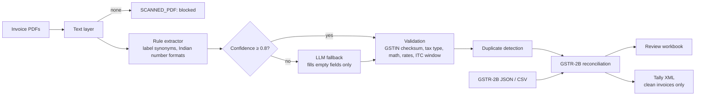

# InvoiceIQ


**Check GST purchase invoices and reconcile them with GSTR-2B before you claim ITC.**
Drop in a folder of supplier PDFs and the GSTR-2B from the portal. Get back a review workbook that says which invoices are safe to post, which are wrong and why, how much input tax credit is at risk, and which suppliers to chase. Clean invoices export straight to Tally.

## The problem

Every month, accounts teams and CA firms key purchase invoices into Tally, then match them by hand against GSTR-2B, the statement of what suppliers actually reported to the GST portal. Credit can only be claimed for invoices that appear there. The errors that cost money are routine and easy to miss at volume:

| What goes wrong | Cost | InvoiceIQ check |
|---|---|---|
| Supplier never filed the invoice | ITC claimed now, reversed later with interest | `missing_in_2b` + supplier chase list |
| Same invoice entered twice (reformatted number) | Double ITC claim | `DUPLICATE`, `POSSIBLE_DUPLICATE` |
| Wrong GSTIN, or billed to another entity | ITC not claimable | `GSTIN_INVALID` (checksum), `BUYER_MISMATCH` |
| IGST on an intra-state supply (or the reverse) | Credit under the wrong head | `TAX_TYPE` |
| Arithmetic errors on the invoice | Overpaid tax | `LINE_MATH`, `TAX_MATH`, `TOTAL_MATH` |
| Old 12% / 28% slab after GST 2.0 (22 Sep 2025) | Likely wrong rate | `RATE_RETIRED` |
| Invoice older than the Section 16(4) window | Credit lapsed | `ITC_LAPSED`, `ITC_DEADLINE` |

**Who buys this:** CA firms doing monthly GST compliance for many clients, and finance teams at SMBs and D2C brands with high purchase volume.

## Try it

```bash
pip install -e ".[app]"
streamlit run app.py               # demo UI with sample invoices preloaded
```

```bash
pip install -e .
invoiceiq data/samples --company-gstin 29AACCN4821K1Z9 \
  --gstr2b data/samples/gstr2b_oct2026.json --out review.xlsx --tally tally.xml
# 12 invoices: 9 ready to post, 3 blocked, 4 issues
# ITC at risk: Rs. 21,394.25
```

## How it works



Design choices that matter in finance:

| Choice | Why |
|---|---|
| Rules first, LLM only below a confidence threshold | Deterministic, free and fast for known layouts (about 90 invoices/s on CPU); the model is paid for only when needed |
| LLM fills empty fields, never overwrites | A figure read by a regex is not replaced by a model guess |
| Every LLM-filled invoice is re-validated | A hallucinated total surfaces as `TOTAL_MATH`, it never reaches the books |
| Fail closed | Anything uncertain is **blocked**, not posted; only clean invoices go to Tally |
| Official GSTIN check digit (mod 36) | Catches typos a format regex accepts |
| Tally vouchers balance to zero | Rounding goes to a round-off ledger; ledger names are configurable |
| PDFs processed in memory | The API never writes client documents to disk |

## Results

Client invoices cannot be published, so `python -m invoiceiq.evaluate` generates a synthetic benchmark: realistic PDFs in several vendor layouts with errors injected at known places, plus a GSTR-2B with the gaps real portals show (unfiled invoices, value differences, ITC marked unavailable, purchases missing from the books). CI runs it on every push and **fails if any score drops below 95%**.

### Dev layouts (160 invoices, 4 layouts, 56 with injected errors)

| Metric | Score |
|---|---|
| Invoices with every field read correctly | 100% |
| Error detection precision / recall | 100% / 100% (11 error types) |
| Clean invoices wrongly blocked | 0 of 104 |
| GSTR-2B reconciliation accuracy | 100% (5 buckets, 160 entries) |
| Throughput | about 90 invoices/s, CPU only |

### Held-out layout: the honest number

A perfect score on layouts the extractor was built against proves little. So one layout, modelled on the government e-invoice (IRN) print, is **held out**: written before the extractor ever ran on it, and never tuned against.

| Metric (rules only, no LLM) | Score |
|---|---|
| Invoices with every field read correctly | 0% |
| Wrong extractions routed to the LLM fallback | **60 of 60** |
| Invoices posted with wrong numbers | **0** (all blocked) |

The rules do not know e-invoice labels such as "Document No." and "Tot Inv. Amt", so they read nothing reliably. What matters is what happens next: the confidence score flagged every one of them for the LLM fallback, and nothing wrong reached the books. Run `python -m invoiceiq.evaluate --llm groq` (or trigger CI with `llm: groq`) to score the fallback itself.

### Error analysis log

| Round | Finding | Fix |
|---|---|---|
| 1 | Dev score 64%: `Inv #:` labels never matched, because `\b` cannot follow `#` | Label boundary changed to `(?!\w)` |
| 2 | First held-out layout (Tally-style "ledger") scored 0% | Four generic gaps: "Total **Tax**able" was filtered as a "Total Tax" line; "Date of Invoice", "Total Invoice Value", "Rounded Off" wording; unit column (Nos, Pcs) in item rows |
| 3 | Ledger layout fixed and moved into the dev set | New held-out layout (e-invoice) written before any run against it |

## API

```bash
pip install -e ".[api]" && uvicorn invoiceiq.api:app      # or: docker build -t invoiceiq . && docker run -p 8000:8000 invoiceiq
```

| Endpoint | Purpose |
|---|---|
| `GET /health` | Liveness |
| `POST /v1/invoices/check` | PDFs (+ optional GSTR-2B) in; invoices, issues and reconciliation as JSON |
| `POST /v1/invoices/export` | Same input; review workbook (base64) and Tally XML |

API keys via `INVOICEIQ_API_KEYS`, per-key rate limit, 10 MB per file, PDF signature check. OpenAPI docs at `/docs`.

## Project layout

```
src/invoiceiq/gstin.py       GSTIN format, state codes, mod-36 check digit
src/invoiceiq/rates.py       GST 2.0 slabs (5 / 18 / 40) and retired slabs
src/invoiceiq/extract/       PDF text, rule extractor, LLM fallback (Groq, Gemini, OpenRouter, Ollama)
src/invoiceiq/validate.py    Compliance checks: identity, dates, rates, tax type, arithmetic
src/invoiceiq/duplicates.py  Exact and possible duplicates
src/invoiceiq/reconcile.py   GSTR-2B reconciliation and supplier chase list
src/invoiceiq/export/        Excel review workbook, Tally XML
src/invoiceiq/synth.py       Synthetic benchmark generator (PDFs + ground truth + GSTR-2B)
src/invoiceiq/evaluate.py    End-to-end scoring with a CI gate
app.py                       Streamlit demo
```

## Limitations

- Text-layer PDFs only. Scanned invoices are blocked as `SCANNED_PDF` (OCR is next on the roadmap).
- Benchmark invoices are synthetic. Real vendor layouts vary more; the held-out score above is the realistic expectation for rules alone.
- HSN-to-rate mapping is not checked: a valid slab on the wrong product passes.
- Not tax advice. A qualified accountant reviews every flagged item.

## Roadmap

OCR for scanned invoices · score the LLM fallback on the held-out layout · HSN rate lookup · email drafts for the supplier chase list · multi-client workspace for CA firms.
